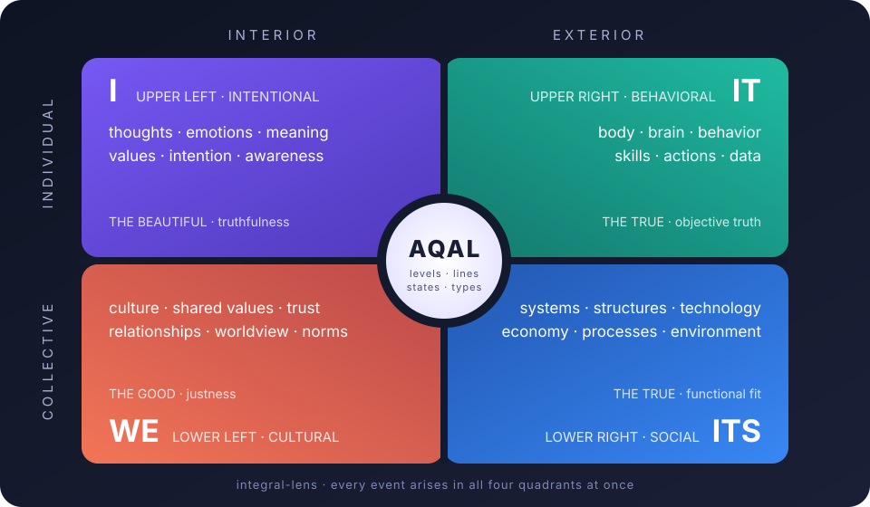

<div align="center">

# 🜂 Integral Lens

### See everything. Miss nothing. Then act.

**Ken Wilber's Integral Vision (AQAL) as a Skill for Claude —
a "theory of everything" you can point at any problem and get back a map *and* a task list.**

[](https://docs.claude.com/en/docs/agents-and-tools/agent-skills/overview)
[](#-install)
[](LICENSE)
[](https://github.com/nftvity/integral-lens/stargazers)



</div>

---

## Why this exists

Most advice is **partial**. Therapists look inside the person. Engineers look at the
system. Managers look at the process. Activists look at the culture. Each is right —
and each misses what the others see. That is why so many plans fail despite real
effort: they push hard on one dimension while the others quietly pull the other way.

Ken Wilber's **Integral Theory** is a map of the minimum set of perspectives you need so
that *nothing essential gets left out*. **Integral Lens** teaches Claude to use that
map rigorously — on your startup, your health, your team, your relationship, your
product launch, a policy debate, or a decision you can't make — and then to turn the
map into **a balanced action plan you can start in the next 48 hours.**

> *"Everybody is right — but only partially."*

## What it does

| | |
|---|---|
| 🧭 **Maps any situation** | Runs a full AQAL scan: **Quadrants** (I · It · We · Its), **Levels** of development, **Lines** of intelligence, **States** of consciousness, and **Types** of personality. |
| 🔍 **Finds your blind spot** | Names the quadrant you over-rely on and the one you ignore — usually the single most valuable insight. |
| 🤝 **Honors every side** | Surfaces what each stakeholder or school of thought gets *right* before its limits. |
| 🎯 **Finds leverage** | Picks the one or two interventions that move all four quadrants at once. |
| ✅ **Extracts tasks** | Builds an **Integral Action Plan**: tetra-interventions, Wake Up / Grow Up / Clean Up / Show Up tags, owners, effort, impact, dependencies, metrics in every quadrant — exportable as Markdown, CSV or JSON for Notion, Jira, Linear, Todoist or GitHub Issues. |
| 🛡️ **Checks itself** | Runs a pitfall check against quadrant absolutism, flatland, the pre/trans fallacy, state/stage confusion, false precision and level-labeling. |

### Seven modes

**See** · **Diagnose** · **Decide** · **Plan** · **Grow** · **Bridge** (conflicts) · **Learn** —
at **Quick**, **Standard** or **Deep** depth. Claude picks the right one from your
request, or you can ask for one by name.

## ⚡ Install

### Claude Code (plugin marketplace)

```bash
/plugin marketplace add nftvity/integral-lens
/plugin install integral-lens@integral-lens
```

### Claude Code (manual)

```bash
git clone https://github.com/nftvity/integral-lens.git
cp -r integral-lens/skills/integral-lens ~/.claude/skills/
```

For a single project, copy it into `.claude/skills/` inside that project instead.

### Claude.ai and the Claude desktop app

1. Download **`integral-lens.zip`** from the [latest release](https://github.com/nftvity/integral-lens/releases/latest).
2. Open **Settings → Capabilities → Skills** and upload the zip.
3. Make sure the skill is switched on.

### Claude API / Agent SDK

Upload the `skills/integral-lens` folder as a custom skill, or place it in your agent's
`.claude/skills/` directory. See the [Agent Skills docs](https://docs.claude.com/en/docs/agents-and-tools/agent-skills/overview).

## 💬 Try it

Just talk normally — the skill activates when an integral, holistic or "what am I
missing?" view would help. Or call it directly:

```text
Use the integral lens on my plan to move to Berlin next year.
```

```text
My 12-person startup keeps missing deadlines. We've tried Jira, a new PM and
daily standups. What are we missing? Give me tasks.
```

```text
Deep integral analysis of AI adoption in our 300-person law firm,
then export the action plan as CSV for Notion.
```

```text
My partner and I keep fighting about money. Bridge mode, please.
```

```text
Explain Ken Wilber's AQAL like I'm smart but new to it, using my own life as the example.
```

## 🧩 What an answer looks like

<details>
<summary><b>Example: "My startup keeps missing deadlines"</b> (click to expand)</summary>

> **The Integral Picture.** Every fix so far has been in the exterior quadrants — tools
> (Jira), roles (a new PM), rituals (standups). Deadlines are slipping for reasons that
> live mainly in the interior quadrants: priorities change whenever the founder has a
> new idea, engineers don't feel safe saying an estimate is unrealistic, and nobody
> shares a definition of "done".
>
> **Overweighted:** LR — tools and process. **Neglected:** LL — safety and shared norms —
> and the founder's own UL.
>
> | # | Task | Quadrant | Up | Done when |
> |---|------|----------|----|-----------|
> | 1 | Founder journals: "What am I afraid of if I don't change priorities?" | UL | Clean Up | Fear named and shared |
> | 2 | Blameless retro, founder speaks last | LL | Clean Up | 3 agreed changes |
> | 4 | All new requests go through PM intake — no work DMs | LR | Show Up | Zero DMs for 2 sprints |
> | 6 | Engineers estimate in pairs and flag doubtful estimates | UR | Grow Up | ≥1 flag discussed per sprint |
>
> **Start in the next 48 hours:** 1) founder does task 1 · 2) PM books the retro · 3)
> founder announces the single intake channel.

Full version: [`examples/startup-missed-deadlines.md`](skills/integral-lens/examples/startup-missed-deadlines.md)

</details>

## 🗺️ The model in 60 seconds

**AQAL = All Quadrants, All Levels, All Lines, All States, All Types.**

- **Quadrants** — every event has an inside and an outside, as an individual and as a
  collective: **I** (experience), **It** (behavior), **We** (culture), **Its** (systems).
  They *tetra-arise*: change one and the other three respond.
- **Levels** — development unfolds in stages that *transcend and include* each other:
  egocentric → ethnocentric → worldcentric → kosmocentric, mapped with a neutral color
  spectrum (Red, Amber, Orange, Green, Teal, Turquoise…), aligned with Spiral Dynamics,
  Kegan, Cook-Greuter, Laloux and others.
- **Lines** — we grow unevenly across many intelligences: cognitive, emotional,
  interpersonal, moral, somatic, spiritual…
- **States** — temporary conditions (stress, flow, sleep, meditation, peak experiences)
  that are not the same as permanent stages.
- **Types** — horizontal styles at every level: personality, masculine/feminine,
  culture.

## 📂 What's inside

```
integral-lens/
├── .claude-plugin/              # Claude Code plugin + marketplace manifest
└── skills/integral-lens/
    ├── SKILL.md                 # the protocol Claude follows
    ├── references/
    │   ├── aqal-model.md        # holons, quadrants, Big Three, core principles
    │   ├── levels-and-lines.md  # altitude spectrum, cross-model table, translation guide, psychographs
    │   ├── states-and-types.md  # great states, Wilber-Combs lattice, typologies
    │   ├── eight-zones.md       # Integral Methodological Pluralism: how would we know?
    │   ├── action-planning.md   # map → tasks: tetra-interventions, metrics, CSV/JSON export
    │   ├── integral-practice.md # Four Ups, Integral Life Practice, the 3-2-1 shadow process
    │   ├── domain-playbooks.md  # business, product, health, politics, ecology, AI, conflict…
    │   └── pitfalls.md          # the quality check + honest limits of the model
    ├── templates/               # analysis and action-plan templates
    └── examples/                # finished analyses at the expected quality
```

The skill uses **progressive disclosure**: Claude loads the short `SKILL.md` first and
reads a reference file only when the task needs it, so it stays fast for quick questions
and goes deep when you ask it to.

## 🌱 Design principles

- **Map, not territory.** AQAL is a way of looking, not a fact about the world.
- **Plain language first.** Jargon only when you want it.
- **Practical over impressive.** Every analysis ends in concrete next actions.
- **Respect for every level.** Developmental stages describe ways of making meaning,
  never the worth of people.
- **Honest about evidence.** Well-supported research and philosophical claims are kept
  apart, and high-stakes topics are pointed to qualified professionals.

## 🤝 Contributing

Contributions are very welcome — especially:

- new **domain playbooks** (law, medicine, design, parenting, spiritual communities, …)
- new **worked examples** in `skills/integral-lens/examples/`
- **translations** of the README
- sharper **pitfall checks** and evaluation prompts

Open an issue or a pull request. If this skill helped you see something you were
missing, **⭐ star the repo** so others can find it too.

## 📚 Further reading

- Ken Wilber — *A Theory of Everything* (2000), *Integral Psychology* (2000),
  *Sex, Ecology, Spirituality* (1995), *A Brief History of Everything* (1996),
  *Integral Spirituality* (2006), *The Integral Vision* (2007)
- Wilber, Patten, Leonard & Morelli — *Integral Life Practice* (2008)
- Frederic Laloux — *Reinventing Organizations* (2014)
- Robert Kegan & Lisa Lahey — *Immunity to Change* (2009)
- Don Beck & Christopher Cowan — *Spiral Dynamics* (1996)

## ⚖️ Disclaimer

Integral Lens is an **independent, unofficial** interpretation of publicly discussed
ideas from Integral Theory. It is not affiliated with, endorsed by, or connected to Ken
Wilber, Integral Institute, or Integral Life. All descriptions are original summaries
written for practical use. It is a thinking tool, not medical, psychological, legal or
financial advice.

---

<div align="center">

**MIT License** · Made with care for people who want to see the whole picture.

</div>
